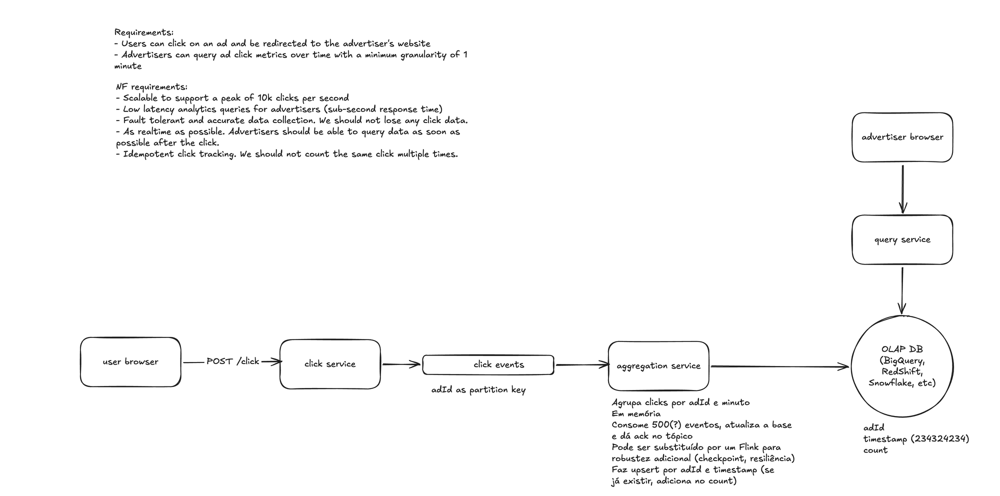

# Ad Click Aggregator

A hands-on implementation of the **Ad Click Aggregator** system design problem from
[Hello Interview](https://www.hellointerview.com/learn/system-design/problem-breakdowns/ad-click-aggregator).

The goal of this project is to go beyond the whiteboard: we will build, configure, and wire together
every component of the system, run it locally, exercise its use cases, and verify that it behaves as
designed.

> **Status:** the write and read paths run end to end locally (click → Kafka → aggregation →
> ClickHouse → query), with simulation scripts and [validation guides](docs/validation/README.md).
> Still missing: the click redirect and click deduplication ([TD-1](docs/tech-debt.md)).

## The Problem

An ad click aggregator collects click events from ads displayed across a platform and lets advertisers
query click metrics over time.

### Functional Requirements

1. **Click and redirect** — when a user clicks an ad, the click is recorded and the user is redirected
   to the advertiser's website.
2. **Query click metrics** — advertisers can query click metrics for their ads over time, with a
   minimum granularity of 1 minute.

### Non-Functional Requirements

- **Scalability** — support peak traffic of ~10k clicks per second.
- **Low-latency analytics** — metric queries should respond in under a second.
- **Fault tolerance and accuracy** — no click data should be lost; aggregated metrics must be accurate.
- **Near real-time** — metrics should be available for querying as soon as possible after a click.
- **Idempotency** — the same click must not be counted more than once.

## Architecture

The diagram below is the reference architecture for this project and will guide its development.
Each component in the diagram maps to a module or piece of infrastructure in this repository.



A text version of the diagram, with per-component details and open points, lives in
[`docs/architecture.md`](docs/architecture.md).

| Diagram component     | Implementation                                                        |
|-----------------------|-----------------------------------------------------------------------|
| click service         | `services/click-service`: receives `POST /click` and publishes click events |
| click events          | Kafka topic, partitioned by `adId`                                    |
| aggregation service   | `services/stream-processor`: groups clicks by `adId` and minute, upserts counts |
| OLAP DB               | ClickHouse, storing `adId`, minute timestamp and `count`              |
| query service         | `services/query-service`: serves click metrics to advertisers         |

The aggregation service starts as a plain Kafka consumer that aggregates in memory, writes a batch
to the OLAP store and then commits its offsets. The diagram notes that it can later be replaced by a
stream processor such as Apache Flink for stronger guarantees (checkpointing, resilience).

## Tech Stack

- **Services:** [Kotlin](https://kotlinlang.org/) (JVM)
- **Messaging:** [Apache Kafka](https://kafka.apache.org/)
- **OLAP storage:** [ClickHouse](https://clickhouse.com/)
- **Local infrastructure:** Docker / Docker Compose

## Project Goals

By the end of this project we will have:

1. **A bootstrap script** that brings up every service and piece of infrastructure (Kafka, ClickHouse,
   the Kotlin services, etc.) with a single command.
2. **Use case simulation scripts** that trigger each functional requirement — e.g. generating ad clicks
   at configurable rates (including duplicate clicks) and querying metrics as an advertiser.
3. **Validation guides** that show how to verify each use case end to end — follow-up queries against
   ClickHouse, inspection of Kafka topics, service logs to check, and the expected results.

### Scope

The services in this project are intentionally simple: they exist to demonstrate the system design,
not to be production-ready. Concerns that are essential in a real production system but unrelated to
the design under study may be left out or only stubbed, such as authentication and authorization,
rate limiting, secrets management, TLS, multi-tenancy, and comprehensive observability.

## Getting Started

### Prerequisites

- JDK 25 (used as the Kotlin JVM toolchain)

The Gradle wrapper is committed, so no local Gradle installation is needed.

### Building

```bash
./gradlew build                            # compile and test every module
./gradlew :services:click-service:run      # run a single service
```

### Running the Local Stack

`scripts/stack.sh` builds the service jars and manages the whole stack (Kafka, ClickHouse and the
services) through Docker Compose. It needs Docker with the Compose v2 plugin.

```bash
scripts/stack.sh          # build and start everything, waiting until healthy (same as `up`)
scripts/stack.sh down     # stop the containers, keeping Kafka and ClickHouse data
scripts/stack.sh reset    # stop the containers and delete all data
```

Once it is up, register a click and query the metrics for the current minute:

```bash
curl -i -X POST localhost:8080/click -H 'Content-Type: application/json' -d '{"adId":"ad-1"}'
curl -s "localhost:8081/ads/ad-1/clicks?from=$(date -u +%Y-%m-%dT%H:%M:00Z)&to=$(date -u -v+1M +%Y-%m-%dT%H:%M:00Z)"
```

(`date -v` is the macOS syntax; on Linux use `date -u -d '+1 min' ...`.)

### Simulating and Validating

```bash
scripts/simulate-clicks.py --rate 1000 --duration 10 --ads 20 --summary /tmp/run.json
scripts/query-metrics.py --summary /tmp/run.json     # every ad's count matches the accepted clicks
scripts/query-metrics.py --ad <adId> --last 1h       # metrics as an advertiser
```

`--duplicates 0.2` sends 20% of the clicks twice. The
[validation guides](docs/validation/README.md) walk through each use case, including throughput at
10k clicks/s and component failures, and show how to inspect Kafka, ClickHouse and the logs.

## Repository Layout

The repository is a single Gradle multi-project build containing every service, shared library,
and supporting asset:

```
ad-click-aggregator/
├── build-logic/               # Gradle convention plugins shared by all modules
├── gradle/libs.versions.toml  # version catalog (single source of dependency versions)
├── settings.gradle.kts        # module declarations
├── libs/
│   └── click-event/           # shared click event contract
├── services/
│   ├── click-service/         # receives clicks and publishes click events
│   ├── stream-processor/      # aggregates clicks into 1-minute windows
│   └── query-service/         # serves click metrics to advertisers
├── infra/                     # Docker Compose and infrastructure configs (Kafka, ClickHouse, ...)
├── scripts/                   # stack management and use case simulation scripts
└── docs/                      # architecture diagram and validation guides
```

Conventions:

- Services depend only on modules under `libs/`, never on each other, so each one remains
  independently deployable.
- Modules apply one of the convention plugins from `build-logic/`:
  `kotlin-library-convention` for libraries and `kotlin-service-convention` for runnable services.
- Dependency versions are declared only in `gradle/libs.versions.toml`.
- New modules must be registered in `settings.gradle.kts`.

## References

- [Hello Interview — Design an Ad Click Aggregator](https://www.hellointerview.com/learn/system-design/problem-breakdowns/ad-click-aggregator)
