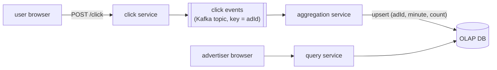

# Architecture

Text version of the reference diagram [`architecture.png`](architecture.png). The diagram is the
source of truth for the design; this document describes it in a searchable form and maps each
component to its place in the repository.

## Requirements

### Functional

1. Users can click on an ad and be redirected to the advertiser's website.
2. Advertisers can query ad click metrics over time with a minimum granularity of 1 minute.

### Non-functional

- **Scalable** to a peak of 10k clicks per second.
- **Low-latency analytics** queries for advertisers (sub-second response time).
- **Fault tolerant and accurate** data collection: no click data may be lost.
- **As real-time as possible**: advertisers can query data soon after the click.
- **Idempotent click tracking**: the same click must not be counted more than once.

## Overview

There are two independent paths:

- **Write path** — `user browser → click service → click events → aggregation service → OLAP DB`.
- **Read path** — `advertiser browser → query service → OLAP DB`.

The only thing the two paths share is the OLAP store.

## Components

| Diagram component   | Implementation                       | Status      |
|---------------------|--------------------------------------|-------------|
| click service       | `services/click-service`             | In progress |
| click events        | Kafka topic `click-events`           | Configured  |
| aggregation service | `services/stream-processor`          | Placeholder |
| OLAP DB             | ClickHouse                           | Not started |
| query service       | `services/query-service`             | Placeholder |
| (event contract)    | `libs/click-event` (`ClickEvent`)    | Done        |

### Click service

Receives `POST /click` from the user's browser and publishes one event per click to the
`click events` topic.

Current implementation (`services/click-service`, Spring Boot, hexagonal layout):

- Body: `{"adId": "..."}`; a missing or blank `adId` returns `400`.
- Assigns a `clickId` (UUID) and a `timestamp` (server receive time), then publishes a `ClickEvent`.
- The request blocks until Kafka acknowledges the write (`acks=all`, idempotent producer), then
  answers `202 Accepted`. Virtual threads keep the blocking cheap.
- If the publish fails or times out it answers `503`, meaning the click was not stored and the caller
  may retry. There is a narrow window in which a click answered with `503` may still be written by
  the broker; only a client-supplied idempotency key would close it.
- The redirect to the advertiser's website (functional requirement 1) is not implemented yet.

### Click events (Kafka)

- Topic `click-events`, **partitioned by `adId`** (message key). All clicks for an ad land in the same
  partition, so a single aggregator instance owns each ad's counts.
- Locally: 12 partitions, replication factor 1.
- Payload is the shared contract `libs/click-event` → `ClickEvent(clickId, adId, timestamp)`, as JSON
  with no Java type headers, so consumers depend only on the contract.

### Aggregation service

Consumes `click events` and turns them into per-minute counts. As annotated in the diagram:

- Groups clicks **by `adId` and minute**, **in memory**.
- Consumes a batch of events (~500, number still open), **updates the database, then acks
  (commits offsets) on the topic**. Committing only after the write means a crash causes
  re-delivery, never loss.
- Writes with an **upsert keyed by `adId` and timestamp**: if the row already exists, the batch's
  count is added to it.
- Can later be replaced by **Apache Flink** for extra robustness (checkpointing, resilience).

Implemented in `services/stream-processor` (currently only a placeholder `Main.kt`). The `clickId` in
each event exists so this stage can deduplicate re-deliveries.

### OLAP DB

The diagram lists BigQuery, Redshift, Snowflake, etc.; this project uses **ClickHouse**. Row shape:

| Column      | Meaning                                  |
|-------------|------------------------------------------|
| `adId`      | the ad                                   |
| `timestamp` | start of the 1-minute bucket (epoch)     |
| `count`     | clicks for that ad in that minute        |

### Query service

Serves click metrics to the advertiser's browser by reading the aggregated rows from the OLAP DB.
Because data is pre-aggregated per minute, queries over any range ≥ 1 minute are a scan over a
small number of rows, which is what keeps them sub-second.

Implemented in `services/query-service` (currently only a placeholder `Main.kt`).

## How the design meets the non-functional requirements

| Requirement      | Mechanism                                                                                   |
|------------------|---------------------------------------------------------------------------------------------|
| 10k clicks/s     | Stateless click service scales horizontally; Kafka partitions spread load across aggregators |
| Sub-second reads | Queries hit pre-aggregated per-minute rows in a columnar OLAP store                         |
| No data loss     | Click acknowledged only after `acks=all`; aggregator commits offsets only after the DB write |
| Near real-time   | Streaming aggregation in small batches instead of periodic batch jobs                       |
| Idempotency      | Idempotent Kafka producer; `clickId` on every event for downstream deduplication             |

## Open points

- Click redirect (`302` to the advertiser URL) is not part of the current `POST /click` flow.
- Batch size and flush interval of the aggregation service (diagram says "500(?)").
- Deduplication strategy by `clickId` in the aggregator, and how it interacts with the additive
  upsert (re-processing a batch after a crash would add its counts twice). Deferred on purpose:
  tracked as TD-1 in [`tech-debt.md`](tech-debt.md).
- Client-side idempotency key to close the `503`-but-written window in the click service.
